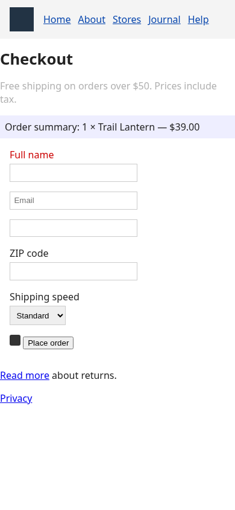
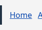
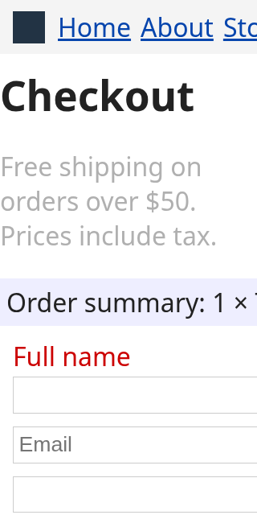

# Accessibility audit report: 127.0.0.1:4177

> 2026-11-15 · WCAG 2.2 AA · 1 page(s) · ada-audit-scripts 4.4.1  
> Every finding is a candidate: confirm it in the DOM and on a screenshot before reporting it. Not legal advice. Not a conformance claim.

## 1. Executive summary

We found 16 candidate accessibility barriers across 1 page (7 detected by deterministic rules, 9 needing a quick human check): 3 to fix now, 13 next, 0 to monitor. 13 are quick wins (under an hour each). Start with the "Fix now" list: those barriers can stop people finishing a key task.

**Top barriers**

1. **F-001 Form fields without a visible, programmatic label** — Screen-reader users hear only "edit text"; voice-control users cannot say the field name; everyone loses the hint once a placeholder disappears. It makes the task very hard or risky. *Fix now · effort low · WCAG 1.3.1, 3.3.2, 4.1.2*
2. **F-002 Images missing a useful text alternative** — Blind users hear a file name or nothing at all, and miss product details, prices or link destinations. It makes the task very hard or risky. *Fix now · effort low · WCAG 1.1.1*
3. **F-003 Page changes on focus or input without warning** — Keyboard and screen-reader users are sent to a new page while just moving through a list or typing. It makes the task very hard or risky. *Fix now · effort medium · WCAG 3.2.2*
4. **F-004 Buttons, links or icons with no accessible name** — Screen-reader and voice-control users hear "button" or "link" and must guess what it does. It makes the task very hard or risky. *Fix next · effort low · WCAG 4.1.2*
5. **F-005 Text contrast too low** — Low-vision users, older users and anyone on a phone in sunlight cannot read the text. It causes real friction. *Fix next · effort low · WCAG 1.4.3*

## 2. Fix plan

### Quick wins (under an hour each, real impact)

- [ ] **F-001** Form fields without a visible, programmatic label · WCAG 1.3.1, 3.3.2, 4.1.2
- [ ] **F-002** Images missing a useful text alternative · WCAG 1.1.1
- [ ] **F-004** Buttons, links or icons with no accessible name · WCAG 4.1.2
- [ ] **F-005** Text contrast too low · WCAG 1.4.3
- [ ] **F-006** Page language not declared · WCAG 3.1.1
- [ ] **F-007** No way to skip repeated blocks · WCAG 2.4.1
- [ ] **F-008** No visible focus indicator · WCAG 2.4.7
- [ ] **F-009** Page regions not marked up (no <main>, headings missing) · WCAG 1.3.1, 2.4.1

### Fix now (3)

- [ ] **F-001** Form fields without a visible, programmatic label · WCAG 1.3.1, 3.3.2, 4.1.2 · critical · effort low · 3 place(s) on 1 page(s)
- [ ] **F-002** Images missing a useful text alternative · WCAG 1.1.1 · critical · effort low · 3 place(s) on 1 page(s)
- [ ] **F-003** Page changes on focus or input without warning · WCAG 3.2.2 · critical · effort medium · 2 place(s) on 1 page(s)

### Fix next (13)

- [ ] **F-004** Buttons, links or icons with no accessible name · WCAG 4.1.2 · critical · effort low · 3 place(s) on 1 page(s)
- [ ] **F-005** Text contrast too low · WCAG 1.4.3 · serious · effort low · 1 place(s) on 1 page(s)
- [ ] **F-006** Page language not declared · WCAG 3.1.1 · serious · effort low · 2 place(s) on 1 page(s)
- [ ] **F-007** No way to skip repeated blocks · WCAG 2.4.1 · serious · effort low · 1 place(s) on 1 page(s) · confirm first
- [ ] **F-008** No visible focus indicator · WCAG 2.4.7 · serious · effort low · 9 place(s) on 1 page(s) · confirm first
- [ ] **F-009** Page regions not marked up (no <main>, headings missing) · WCAG 1.3.1, 2.4.1 · serious · effort low · 2 place(s) on 1 page(s) · confirm first
- [ ] **F-010** Personal-data field missing autocomplete · WCAG 1.3.5 · moderate · effort low · 4 place(s) on 1 page(s)
- [ ] **F-011** Required field has no visible cue · WCAG 3.3.2 · moderate · effort low · 2 place(s) on 1 page(s) · confirm first
- [ ] **F-012** Click handler on an element keyboard users cannot reach · WCAG 2.1.1 · serious · effort medium · 1 place(s) on 1 page(s) · confirm first
- [ ] **F-013** Focus moves to an off-screen item · WCAG 2.4.7 · moderate · effort low · 1 place(s) on 1 page(s) · confirm first
- [ ] **F-014** Text styled as a heading but not a heading · WCAG 1.3.1, 2.4.6 · moderate · effort low · 1 place(s) on 1 page(s) · confirm first
- [ ] **F-015** Vague link text · WCAG 2.4.4 · moderate · effort low · 1 place(s) on 1 page(s) · confirm first
- [ ] **F-016** Content does not reflow on small screens or zoom · WCAG 1.4.10 · serious · effort medium · 1 place(s) on 1 page(s) · confirm first

### Monitor (0)

_Nothing in this group._

Order inside each group: impact × confidence × reach ÷ effort. Fix shared templates and components before single pages.

## 3. Findings at a glance

| ID | Issue | WCAG (level) | Severity | Confidence | Effort | Plan | Pages |
|---|---|---|---|---|---|---|---|
| F-001 | Form fields without a visible, programmatic label | 1.3.1 (A), 3.3.2 (A), 4.1.2 (A) | Critical | Automated: certain | Low | Fix now | 1 |
| F-002 | Images missing a useful text alternative | 1.1.1 (A) | Critical | Automated: certain | Low | Fix now | 1 |
| F-003 | Page changes on focus or input without warning | 3.2.2 (A) | Critical | Automated: certain | Medium | Fix now | 1 |
| F-004 | Buttons, links or icons with no accessible name | 4.1.2 (A) | Critical | Automated: certain | Low | Fix next | 1 |
| F-005 | Text contrast too low | 1.4.3 (AA) | Serious | Automated: certain | Low | Fix next | 1 |
| F-006 | Page language not declared | 3.1.1 (A) | Serious | Automated: certain | Low | Fix next | 1 |
| F-007 | No way to skip repeated blocks | 2.4.1 (A) | Serious | Needs human review | Low | Fix next | 1 |
| F-008 | No visible focus indicator | 2.4.7 (AA) | Serious | Needs human review | Low | Fix next | 1 |
| F-009 | Page regions not marked up (no <main>, headings missing) | 1.3.1 (A), 2.4.1 (A) | Serious | Needs human review | Low | Fix next | 1 |
| F-010 | Personal-data field missing autocomplete | 1.3.5 (AA) | Moderate | Automated: certain | Low | Fix next | 1 |
| F-011 | Required field has no visible cue | 3.3.2 (A) | Moderate | Needs human review | Low | Fix next | 1 |
| F-012 | Click handler on an element keyboard users cannot reach | 2.1.1 (A) | Serious | Needs human review | Medium | Fix next | 1 |
| F-013 | Focus moves to an off-screen item | 2.4.7 (AA) | Moderate | Needs human review | Low | Fix next | 1 |
| F-014 | Text styled as a heading but not a heading | 1.3.1 (A), 2.4.6 (AA) | Moderate | Needs human review | Low | Fix next | 1 |
| F-015 | Vague link text | 2.4.4 (A) | Moderate | Needs human review | Low | Fix next | 1 |
| F-016 | Content does not reflow on small screens or zoom | 1.4.10 (AA) | Serious | Needs human review | Medium | Fix next | 1 |

## 4. Findings and how to fix them

### F-001 Form fields without a visible, programmatic label

**Critical · Automated: certain · found by 2 tools · Fix now · effort low**

- **What's wrong:** Form fields without a visible, programmatic label. Seen in 3 place(s) on 1 page(s).
- **Who it hurts:** Screen-reader users hear only "edit text"; voice-control users cannot say the field name; everyone loses the hint once a placeholder disappears.
- **WCAG:** [1.3.1 Info and Relationships](https://www.w3.org/WAI/WCAG22/Understanding/info-and-relationships.html) (A); [3.3.2 Labels or Instructions](https://www.w3.org/WAI/WCAG22/Understanding/labels-or-instructions.html) (A); [4.1.2 Name, Role, Value](https://www.w3.org/WAI/WCAG22/Understanding/name-role-value.html) (A)
- **How found:** Automated (axe-core 4.14.0); Accessibility tree + DOM inspection (scripted)
- **Where:**
  - <http://127.0.0.1:4177/checkout-bad.html> · `#name` · 390/1440 px · screenshot: [axe__127_0_0_1_4177_checkout_bad_html_1440.png](screenshots/axe__127_0_0_1_4177_checkout_bad_html_1440.png), [axe__127_0_0_1_4177_checkout_bad_html_390.png](screenshots/axe__127_0_0_1_4177_checkout_bad_html_390.png)
  - <http://127.0.0.1:4177/checkout-bad.html> · `#phone` · 390/1440 px · screenshot: [axe__127_0_0_1_4177_checkout_bad_html_1440.png](screenshots/axe__127_0_0_1_4177_checkout_bad_html_1440.png), [axe__127_0_0_1_4177_checkout_bad_html_390.png](screenshots/axe__127_0_0_1_4177_checkout_bad_html_390.png)
  - <http://127.0.0.1:4177/checkout-bad.html> · `input#email` · 390 px

  
  <br>*F-001: viewport screenshot (/checkout-bad.html at 390 px wide). Confirm the barrier on the live page.*

- **Evidence (first location):**

  ```text
  <input id="name" name="name" required="">
  Form elements must have labels: Fix any of the following:   Element does not have an implicit (wrapped) <label>
  ```

- **How to fix:**
  1. Give every input, select and textarea a visible <label for="id"> (placeholder text is not a label).
  2. If the design hides the label, keep it in the DOM with a visually-hidden class, never display:none.
  3. Group related controls (radio sets, date parts) in <fieldset> with a <legend>.

  Before:

  ```html
  <input type="email" placeholder="Email">
  ```

  After:

  ```html
  <label for="email">Email</label>
  <input id="email" type="email" autocomplete="email">
  ```

- **Where to change it** (typical location; menus differ by theme, app and version; [sources](https://github.com/eedgarivann/ada-audit-scripts/blob/main/docs/platform-hints.md)):
  - Shopify: Theme code: sections/*.liquid or snippets for forms; add <label for> and keep the visually-hidden class.
- **How to verify:** Click the label text: focus must move into the field. In DevTools > Accessibility the field's Name equals the visible label.
- **References:** <https://www.w3.org/WAI/tutorials/forms/labels/> · <https://dequeuniversity.com/rules/axe/4.14/label> · <https://www.w3.org/WAI/WCAG22/Understanding/info-and-relationships.html> · <https://www.w3.org/WAI/WCAG22/Understanding/labels-or-instructions.html>

### F-002 Images missing a useful text alternative

**Critical · Automated: certain · found by 3 tools · Fix now · effort low**

- **What's wrong:** Images missing a useful text alternative. Seen in 3 place(s) on 1 page(s).
- **Who it hurts:** Blind users hear a file name or nothing at all, and miss product details, prices or link destinations.
- **WCAG:** [1.1.1 Non-text Content](https://www.w3.org/WAI/WCAG22/Understanding/non-text-content.html) (A)
- **How found:** Automated (axe-core 4.14.0); DOM inspection (scripted); Simulated SR (Guidepup Virtual Screen Reader 0.33.0)
- **Where:**
  - <http://127.0.0.1:4177/checkout-bad.html> · `img` · 390/1440 px · screenshot: [axe__127_0_0_1_4177_checkout_bad_html_1440.png](screenshots/axe__127_0_0_1_4177_checkout_bad_html_1440.png), [axe__127_0_0_1_4177_checkout_bad_html_390.png](screenshots/axe__127_0_0_1_4177_checkout_bad_html_390.png)
  - <http://127.0.0.1:4177/checkout-bad.html> · `img svg%3E alt=(none)`
  - <http://127.0.0.1:4177/checkout-bad.html> · 390 px

  
  <br>*F-002: viewport screenshot (/checkout-bad.html at 390 px wide). Confirm the barrier on the live page.*

- **Evidence (first location):**

  ```text
  
  Images must have alternative text: Fix any of the following:   Element does not have an alt attribute
  ```

- **How to fix:**
  1. Informative image: alt describes what it conveys ("Red trail lantern, 300 lumens").
  2. Decorative image: alt="" (empty), never missing.
  3. Linked image: alt names the destination ("Trail lantern details").
  4. Images of text: use real text, or put all the text in the alt.

  Before:

  ```html
  
  ```

  After:

  ```html
  
  ```

- **Where to change it** (typical location; menus differ by theme, app and version; [sources](https://github.com/eedgarivann/ada-audit-scripts/blob/main/docs/platform-hints.md)):
  - Shopify: Products > open the product > click the media item > Add alt text; theme section images: theme editor > section > image > Edit; custom Liquid: {{ image | image_tag: alt: image.alt }}.
- **How to verify:** Open the images review sheet (inventory *_images.html) and compare each alt to the picture; screen reader reads a meaningful phrase.
- **References:** <https://dequeuniversity.com/rules/axe/4.14/image-alt> · <https://www.w3.org/WAI/WCAG22/Understanding/non-text-content.html>

### F-003 Page changes on focus or input without warning

**Critical · Automated: certain · Fix now · effort medium**

- **What's wrong:** Page changes on focus or input without warning. Seen in 2 place(s) on 1 page(s).
- **Who it hurts:** Keyboard and screen-reader users are sent to a new page while just moving through a list or typing.
- **WCAG:** [3.2.2 On Input](https://www.w3.org/WAI/WCAG22/Understanding/on-input.html) (A)
- **How found:** Keyboard/DOM test (scripted, navigations aborted)
- **Where:**
  - <http://127.0.0.1:4177/checkout-bad.html> · `select "Shipping speed"` · 1440 px
  - <http://127.0.0.1:4177/checkout-bad.html> · `select#ship` · 1440 px
- **Evidence (first location):**

  ```text
  CHANGE-ON-INPUT	select 0 "Shipping speed" ArrowDown -> GET http://127.0.0.1:4177/checkout-bad.html?ship=exp (3.2.2; aborted, not followed)
  ```

- **How to fix:**
  1. Do not navigate on select change or on focus; add a "Go"/"Apply" button.
  2. If a change must happen, explain it before the control.

  Before:

  ```html
  <select onchange="location=this.value">
  ```

  After:

  ```html
  <select id="sort">...</select> <button type="submit">Apply</button>
  ```

- **How to verify:** Arrow through each select and Tab across fields: nothing navigates or opens until you press the button.
- **References:** <https://www.w3.org/WAI/WCAG22/Understanding/on-input.html>

### F-004 Buttons, links or icons with no accessible name

**Critical · Automated: certain · found by 2 tools · Fix next · effort low**

- **What's wrong:** Buttons, links or icons with no accessible name. Seen in 3 place(s) on 1 page(s).
- **Who it hurts:** Screen-reader and voice-control users hear "button" or "link" and must guess what it does.
- **WCAG:** [4.1.2 Name, Role, Value](https://www.w3.org/WAI/WCAG22/Understanding/name-role-value.html) (A)
- **How found:** Automated (axe-core 4.14.0); Simulated SR (Guidepup Virtual Screen Reader 0.33.0)
- **Where:**
  - <http://127.0.0.1:4177/checkout-bad.html> · `button` · 390 px
  - <http://127.0.0.1:4177/checkout-bad.html> · `button[onclick="location.href='cart.html'"]` · 390/1440 px · screenshot: [axe__127_0_0_1_4177_checkout_bad_html_1440.png](screenshots/axe__127_0_0_1_4177_checkout_bad_html_1440.png), [axe__127_0_0_1_4177_checkout_bad_html_390.png](screenshots/axe__127_0_0_1_4177_checkout_bad_html_390.png)
  - <http://127.0.0.1:4177/checkout-bad.html> · `image` · 390 px

  
  <br>*F-004: viewport screenshot (/checkout-bad.html at 390 px wide). Confirm the barrier on the live page.*

- **Evidence (first location):**

  ```text
  10	NO-NAME	button
  ```

- **How to fix:**
  1. Give icon-only controls a name: visible text, aria-label, or visually-hidden text.
  2. Make the accessible name start with the visible label (2.5.3 Label in Name).
  3. For SVG icons inside a named control, add aria-hidden="true" to the SVG.

  Before:

  ```html
  <a href="/cart"><svg>...</svg></a>
  ```

  After:

  ```html
  <a href="/cart"><svg aria-hidden="true">...</svg><span class="visually-hidden">Cart, 1 item</span></a>
  ```

- **Where to change it** (typical location; menus differ by theme, app and version; [sources](https://github.com/eedgarivann/ada-audit-scripts/blob/main/docs/platform-hints.md)):
  - Shopify: Header cart/search icons in sections/header.liquid: add visually-hidden text.
- **How to verify:** DevTools > Accessibility: each control has a Name; voice control "click Cart" works.
- **References:** <https://dequeuniversity.com/rules/axe/4.14/button-name> · <https://www.w3.org/WAI/WCAG22/Understanding/name-role-value.html>

### F-005 Text contrast too low

**Serious · Automated: certain · Fix next · effort low**

- **What's wrong:** Text contrast too low. Seen in 1 place(s) on 1 page(s).
- **Who it hurts:** Low-vision users, older users and anyone on a phone in sunlight cannot read the text.
- **WCAG:** [1.4.3 Contrast (Minimum)](https://www.w3.org/WAI/WCAG22/Understanding/contrast-minimum.html) (AA)
- **How found:** Automated (axe-core 4.14.0)
- **Where:**
  - <http://127.0.0.1:4177/checkout-bad.html> · `.muted` · 390/1440 px · screenshot: [axe__127_0_0_1_4177_checkout_bad_html_1440.png](screenshots/axe__127_0_0_1_4177_checkout_bad_html_1440.png), [axe__127_0_0_1_4177_checkout_bad_html_390.png](screenshots/axe__127_0_0_1_4177_checkout_bad_html_390.png)

  
  <br>*F-005: viewport screenshot (/checkout-bad.html at 390 px wide). Confirm the barrier on the live page.*

- **Evidence (first location):**

  ```text
  <p class="muted">Free shipping on orders over $50. Prices include tax.</p>
  Elements must meet minimum color contrast ratio thresholds: Fix any of the following:   Element has insufficient color contrast of 2.16 (foreground color: #b0b0b0, background color: #ffffff, font size: 12.0pt (16px), font weight: normal). Expected contrast ratio of 4.5:1
  ```

- **How to fix:**
  1. Raise text contrast to at least 4.5:1 (3:1 for 24px+ or 18.66px+ bold text).
  2. Fix the design token (brand colour) once rather than per element.
  3. Check hover, focus and disabled-looking states too.

  Before:

  ```html
  color: #9a9a9a; /* 2.8:1 on white */
  ```

  After:

  ```html
  color: #595959; /* 7:1 on white */
  ```

- **Where to change it** (typical location; menus differ by theme, app and version; [sources](https://github.com/eedgarivann/ada-audit-scripts/blob/main/docs/platform-hints.md)):
  - Shopify: Theme settings > Colors (color schemes).
- **How to verify:** Measure with a contrast checker on the rendered pixels (not just CSS): 4.5:1 or better; re-run axe color-contrast.
- **References:** <https://dequeuniversity.com/rules/axe/4.14/color-contrast> · <https://www.w3.org/WAI/WCAG22/Understanding/contrast-minimum.html>

### F-006 Page language not declared

**Serious · Automated: certain · found by 2 tools · Fix next · effort low**

- **What's wrong:** Page language not declared. Seen in 2 place(s) on 1 page(s).
- **Who it hurts:** Screen readers read the text with the wrong voice and pronunciation.
- **WCAG:** [3.1.1 Language of Page](https://www.w3.org/WAI/WCAG22/Understanding/language-of-page.html) (A)
- **How found:** Automated (axe-core 4.14.0); DOM inspection (scripted)
- **Where:**
  - <http://127.0.0.1:4177/checkout-bad.html> · `html` · 390/1440 px · screenshot: [axe__127_0_0_1_4177_checkout_bad_html_1440.png](screenshots/axe__127_0_0_1_4177_checkout_bad_html_1440.png), [axe__127_0_0_1_4177_checkout_bad_html_390.png](screenshots/axe__127_0_0_1_4177_checkout_bad_html_390.png)
  - <http://127.0.0.1:4177/checkout-bad.html>

  
  <br>*F-006: viewport screenshot (/checkout-bad.html at 390 px wide). Confirm the barrier on the live page.*

- **Evidence (first location):**

  ```text
  <html>
  <html> element must have a lang attribute: Fix any of the following:   The <html> element does not have a lang attribute
  ```

- **How to fix:**
  1. Set <html lang="en"> (or the page language); mark foreign-language passages with lang on the element.

  Before:

  ```html
  <html>
  ```

  After:

  ```html
  <html lang="en">
  ```

- **Where to change it** (typical location; menus differ by theme, app and version; [sources](https://github.com/eedgarivann/ada-audit-scripts/blob/main/docs/platform-hints.md)):
  - Shopify: Settings > Languages (theme outputs request.locale.iso_code).
- **How to verify:** View source: <html lang> matches the content language.
- **References:** <https://dequeuniversity.com/rules/axe/4.14/html-has-lang> · <https://www.w3.org/WAI/WCAG22/Understanding/language-of-page.html>

### F-007 No way to skip repeated blocks

**Serious · Needs human review · Fix next · effort low**

- **What's wrong:** No working way to skip repeated navigation. Seen in 1 place(s) on 1 page(s).
- **Who it hurts:** Keyboard and switch users must press Tab through every menu link on every page before reaching the content.
- **WCAG:** [2.4.1 Bypass Blocks](https://www.w3.org/WAI/WCAG22/Understanding/bypass-blocks.html) (A)
- **How found:** Keyboard + layout test (scripted)
- **Where:**
  - <http://127.0.0.1:4177/checkout-bad.html> · 390/1440 px
- **Evidence (first location):**

  ```text
  BYPASS-NONE(2.4.1,high)	14 focusable(s) before the content and no working skip link, main landmark or headings
  ```

- **How to fix:**
  1. Make the first focusable element a "Skip to main content" link.
  2. Point it at the main content: <main id="main" tabindex="-1">.
  3. Keep it visible when focused (do not hide it with display:none).

  Before:

  ```html
  <a href="#content" class="hidden">Skip</a> <!-- #content does not exist -->
  ```

  After:

  ```html
  <a class="skip-link" href="#main">Skip to main content</a>
  ...
  <main id="main" tabindex="-1">
  <style>.skip-link{position:absolute;left:-9999px}.skip-link:focus{left:1rem;top:1rem}</style>
  ```

- **Where to change it** (typical location; menus differ by theme, app and version; [sources](https://github.com/eedgarivann/ada-audit-scripts/blob/main/docs/platform-hints.md)):
  - Shopify: Dawn-based themes include `skip-to-content-link` in layout/theme.liquid; check the target id after customising.
- **How to verify:** Load the page, press Tab once: the skip link appears; press Enter, then Tab: focus lands on the first item inside the main content.
- **References:** <https://www.w3.org/WAI/WCAG22/Understanding/bypass-blocks.html>

### F-008 No visible focus indicator

**Serious · Needs human review · Fix next · effort low**

- **What's wrong:** Keyboard focus is invisible. Seen in 9 place(s) on 1 page(s).
- **Who it hurts:** Sighted keyboard users (motor disabilities, power users, low vision) cannot see where they are on the page.
- **WCAG:** [2.4.7 Focus Visible](https://www.w3.org/WAI/WCAG22/Understanding/focus-visible.html) (AA)
- **How found:** Keyboard test (scripted, Chromium via Playwright 1.65.1)
- **Where:**
  - <http://127.0.0.1:4177/checkout-bad.html> · `a "About"` · 390/1440 px · screenshot: [tab-walk__127_0_0_1_4177_checkout_bad_html_1440__02.png](screenshots/tab-walk__127_0_0_1_4177_checkout_bad_html_1440__02.png), [tab-walk__127_0_0_1_4177_checkout_bad_html_390__02.png](screenshots/tab-walk__127_0_0_1_4177_checkout_bad_html_390__02.png)
  - <http://127.0.0.1:4177/checkout-bad.html> · `a "Help"` · 390/1440 px · screenshot: [tab-walk__127_0_0_1_4177_checkout_bad_html_1440__05.png](screenshots/tab-walk__127_0_0_1_4177_checkout_bad_html_1440__05.png), [tab-walk__127_0_0_1_4177_checkout_bad_html_390__05.png](screenshots/tab-walk__127_0_0_1_4177_checkout_bad_html_390__05.png)
  - <http://127.0.0.1:4177/checkout-bad.html> · `a "Home"` · 390/1440 px · screenshot: [tab-walk__127_0_0_1_4177_checkout_bad_html_1440__01.png](screenshots/tab-walk__127_0_0_1_4177_checkout_bad_html_1440__01.png), [tab-walk__127_0_0_1_4177_checkout_bad_html_390__01.png](screenshots/tab-walk__127_0_0_1_4177_checkout_bad_html_390__01.png)
  - <http://127.0.0.1:4177/checkout-bad.html> · `a "Journal"` · 390/1440 px · screenshot: [tab-walk__127_0_0_1_4177_checkout_bad_html_1440__04.png](screenshots/tab-walk__127_0_0_1_4177_checkout_bad_html_1440__04.png), [tab-walk__127_0_0_1_4177_checkout_bad_html_390__04.png](screenshots/tab-walk__127_0_0_1_4177_checkout_bad_html_390__04.png)
  - <http://127.0.0.1:4177/checkout-bad.html> · `a "Privacy"` · 390/1440 px · screenshot: [tab-walk__127_0_0_1_4177_checkout_bad_html_1440__14.png](screenshots/tab-walk__127_0_0_1_4177_checkout_bad_html_1440__14.png), [tab-walk__127_0_0_1_4177_checkout_bad_html_390__14.png](screenshots/tab-walk__127_0_0_1_4177_checkout_bad_html_390__14.png)
  - <http://127.0.0.1:4177/checkout-bad.html> · `a "Read more"` · 390/1440 px · screenshot: [tab-walk__127_0_0_1_4177_checkout_bad_html_1440__13.png](screenshots/tab-walk__127_0_0_1_4177_checkout_bad_html_1440__13.png), [tab-walk__127_0_0_1_4177_checkout_bad_html_390__13.png](screenshots/tab-walk__127_0_0_1_4177_checkout_bad_html_390__13.png)
  - <http://127.0.0.1:4177/checkout-bad.html> · `a "Stores"` · 390/1440 px · screenshot: [tab-walk__127_0_0_1_4177_checkout_bad_html_1440__03.png](screenshots/tab-walk__127_0_0_1_4177_checkout_bad_html_1440__03.png), [tab-walk__127_0_0_1_4177_checkout_bad_html_390__03.png](screenshots/tab-walk__127_0_0_1_4177_checkout_bad_html_390__03.png)
  - <http://127.0.0.1:4177/checkout-bad.html> · `button ""` · 390/1440 px · screenshot: [tab-walk__127_0_0_1_4177_checkout_bad_html_1440__06.png](screenshots/tab-walk__127_0_0_1_4177_checkout_bad_html_1440__06.png)
  - …and 1 more (see findings.json)

  
  <br>*F-008: cropped screenshot of the focused control (/checkout-bad.html at 390 px wide). Confirm the barrier on the live page.*

- **Evidence (first location):**

  ```text
  2	a	"About"	about.html	ring=NONE	NO-RING?
  ```

- **How to fix:**
  1. Remove outline:none / outline:0 rules that have no replacement.
  2. Add a clear :focus-visible style (2px+ outline with 3:1 contrast against the background).

  Before:

  ```html
  a:focus, button:focus { outline: none; }
  ```

  After:

  ```html
  :focus-visible { outline: 3px solid #1a5fb4; outline-offset: 2px; }
  ```

- **Where to change it** (typical location; menus differ by theme, app and version; [sources](https://github.com/eedgarivann/ada-audit-scripts/blob/main/docs/platform-hints.md)):
  - Shopify: assets/base.css (Dawn uses :focus-visible; check custom CSS overrides).
- **How to verify:** Tab through the page: every focused item shows a visible ring.
- **References:** <https://www.w3.org/WAI/WCAG22/Understanding/focus-visible.html>

### F-009 Page regions not marked up (no <main>, headings missing)

**Serious · Needs human review · found by 3 tools · Fix next · effort low**

- **What's wrong:** Page regions not marked up (no <main>, headings missing). Seen in 2 place(s) on 1 page(s).
- **Who it hurts:** Screen-reader users navigate by landmarks and headings; without them they must listen to the whole page.
- **WCAG:** [1.3.1 Info and Relationships](https://www.w3.org/WAI/WCAG22/Understanding/info-and-relationships.html) (A); [2.4.1 Bypass Blocks](https://www.w3.org/WAI/WCAG22/Understanding/bypass-blocks.html) (A)
- **How found:** Keyboard + layout test (scripted); DOM inspection (scripted); Simulated SR (Guidepup Virtual Screen Reader 0.33.0)
- **Where:**
  - <http://127.0.0.1:4177/checkout-bad.html> · `content sections use styled text, not headings (1.3.1, 2.4.6 "headings not programmatically determined")`
  - <http://127.0.0.1:4177/checkout-bad.html> · 390/1440 px
- **Evidence (first location):**

  ```text
  NO-REAL-HEADINGS	content sections use styled text, not headings (1.3.1, 2.4.6 "headings not programmatically determined")
  ```

- **How to fix:**
  1. Wrap the primary content in one <main>; use <header>, <nav aria-label>, <footer>.
  2. Give each page one <h1> and use real <h2>/<h3> headings for sections (not bold text).

  Before:

  ```html
  <div class="content"><div class="title">Shop</div>
  ```

  After:

  ```html
  <main id="main"><h1>Shop</h1>
  ```

- **Where to change it** (typical location; menus differ by theme, app and version; [sources](https://github.com/eedgarivann/ada-audit-scripts/blob/main/docs/platform-hints.md)):
  - Shopify: layout/theme.liquid: <main id="MainContent" role="main">; section titles as headings.
- **How to verify:** Screen reader landmarks list (NVDA D / VoiceOver rotor) shows main and navigation; headings list reads as an outline of the page.
- **References:** <https://www.w3.org/WAI/WCAG22/Understanding/info-and-relationships.html> · <https://www.w3.org/WAI/WCAG22/Understanding/bypass-blocks.html>

### F-010 Personal-data field missing autocomplete

**Moderate · Automated: certain · Fix next · effort low**

- **What's wrong:** Personal-data fields missing autocomplete. Seen in 4 place(s) on 1 page(s).
- **Who it hurts:** People with memory, dexterity or cognitive disabilities must retype details that the browser could fill; slow, error-prone on mobile.
- **WCAG:** [1.3.5 Identify Input Purpose](https://www.w3.org/WAI/WCAG22/Understanding/identify-input-purpose.html) (AA)
- **How found:** Accessibility tree + DOM inspection (scripted)
- **Where:**
  - <http://127.0.0.1:4177/checkout-bad.html> · `input#email` · 390 px
  - <http://127.0.0.1:4177/checkout-bad.html> · `input#name` · 390 px
  - <http://127.0.0.1:4177/checkout-bad.html> · `input#phone` · 390 px
  - <http://127.0.0.1:4177/checkout-bad.html> · `input#zip` · 390 px
- **Evidence (first location):**

  ```text
  input[email] id=email name=email label="" placeholder="Email" required=true autocomplete="" PLACEHOLDER-ONLY NO-AUTOCOMPLETE(email; 1.3.5) REQUIRED-NOT-SHOWN?(3.3.2: check visible cue)
  ```

- **How to fix:**
  1. Add the matching HTML autocomplete token to each field that collects the user's own data (name, email, tel, street-address, postal-code, cc-number, one-time-code...).
  2. Do not set autocomplete="off" on those fields.

  Before:

  ```html
  <input id="zip" name="zip">
  ```

  After:

  ```html
  <input id="zip" name="zip" autocomplete="postal-code" inputmode="numeric">
  ```

- **Where to change it** (typical location; menus differ by theme, app and version; [sources](https://github.com/eedgarivann/ada-audit-scripts/blob/main/docs/platform-hints.md)):
  - Shopify: Shopify's own checkout fields are controlled by Shopify; fix custom forms (contact, newsletter, account) in theme Liquid.
- **How to verify:** Open the form in Chrome or Safari with a saved address/profile: each field offers autofill with the right value.
- **References:** <https://www.w3.org/TR/WCAG22/#input-purposes> · <https://www.w3.org/WAI/WCAG22/Understanding/identify-input-purpose.html>

### F-011 Required field has no visible cue

**Moderate · Needs human review · Fix next · effort low**

- **What's wrong:** Required fields shown by colour only (or not at all). Seen in 2 place(s) on 1 page(s).
- **Who it hurts:** Colour-blind and screen-reader users cannot tell which fields are required until they get errors.
- **WCAG:** [3.3.2 Labels or Instructions](https://www.w3.org/WAI/WCAG22/Understanding/labels-or-instructions.html) (A)
- **How found:** Accessibility tree + DOM inspection (scripted)
- **Where:**
  - <http://127.0.0.1:4177/checkout-bad.html> · `input#email` · 390 px
  - <http://127.0.0.1:4177/checkout-bad.html> · `input#name` · 390 px
- **Evidence (first location):**

  ```text
  input[email] id=email name=email label="" placeholder="Email" required=true autocomplete="" PLACEHOLDER-ONLY NO-AUTOCOMPLETE(email; 1.3.5) REQUIRED-NOT-SHOWN?(3.3.2: check visible cue)
  ```

- **How to fix:**
  1. Mark required fields in text: "(required)" in the label, or an asterisk explained at the top of the form.
  2. Add the required attribute (or aria-required="true") so assistive technology announces it.

  Before:

  ```html
  <label style="color:red">Name</label><input id="n">
  ```

  After:

  ```html
  <label for="n">Name <span>(required)</span></label><input id="n" required>
  ```

- **Where to change it** (typical location; menus differ by theme, app and version; [sources](https://github.com/eedgarivann/ada-audit-scripts/blob/main/docs/platform-hints.md)):
  - Shopify: Theme form snippet: add "(required)" text and the required attribute.
- **How to verify:** Grayscale the page (DevTools > Rendering > Emulate vision deficiency: achromatopsia): every required field is still identifiable; screen reader says "required".
- **References:** <https://www.w3.org/WAI/WCAG22/Understanding/labels-or-instructions.html>

### F-012 Click handler on an element keyboard users cannot reach

**Serious · Needs human review · Fix next · effort medium**

- **What's wrong:** Controls that only work with a mouse. Seen in 1 place(s) on 1 page(s).
- **Who it hurts:** Keyboard, switch and voice users cannot open the menu, accept the banner or press the button; the journey stops.
- **WCAG:** [2.1.1 Keyboard](https://www.w3.org/WAI/WCAG22/Understanding/keyboard.html) (A)
- **How found:** Keyboard/DOM test (scripted, navigations aborted)
- **Where:**
  - <http://127.0.0.1:4177/checkout-bad.html> · `div.icon` · 1440 px
- **Evidence (first location):**

  ```text
  MOUSE-ONLY	div.icon "" role=presentation	(2.1.1/4.1.2 candidate: not keyboard reachable)
  ```

- **How to fix:**
  1. Use native <button> for actions and <a href> for navigation; avoid clickable <div>/<span>.
  2. If a custom control is unavoidable: tabindex="0", role, and Enter/Space handlers.
  3. Menus must open on Enter/Space (and click), not only on hover.

  Before:

  ```html
  <div class="accept" onclick="accept()">Accept</div>
  ```

  After:

  ```html
  <button type="button" onclick="accept()">Accept</button>
  ```

- **Where to change it** (typical location; menus differ by theme, app and version; [sources](https://github.com/eedgarivann/ada-audit-scripts/blob/main/docs/platform-hints.md)):
  - Shopify: Theme JS: bind to <button>; for mega menus use <details>/<summary> or aria-expanded buttons.
- **How to verify:** Unplug the mouse: complete the journey with Tab, Shift+Tab, Enter, Space, arrows and Esc only.
- **References:** <https://www.w3.org/WAI/WCAG22/Understanding/keyboard.html>

### F-013 Focus moves to an off-screen item

**Moderate · Needs human review · Fix next · effort low**

- **What's wrong:** Focused item hidden behind a sticky header, banner or overlay. Seen in 1 place(s) on 1 page(s).
- **Who it hurts:** Keyboard users tab to a link they cannot see, and may activate the wrong thing.
- **WCAG:** [2.4.7 Focus Visible](https://www.w3.org/WAI/WCAG22/Understanding/focus-visible.html) (AA)
- **How found:** Keyboard test (scripted, Chromium via Playwright 1.65.1)
- **Where:**
  - <http://127.0.0.1:4177/checkout-bad.html> · `button ""` · 390 px
- **Evidence (first location):**

  ```text
  6	button	""		ring=NONE	NO-RING? OFFSCREEN TEXT 1.66:1
  ```

- **How to fix:**
  1. Add scroll-padding-top equal to the sticky header height.
  2. Do not let cookie or chat banners cover content while it has focus; make them dismissible.

  After:

  ```html
  html { scroll-padding-top: 6rem; } /* sticky header height */
  ```

- **How to verify:** Tab through the whole page at 390 px and 1440 px: no focused item is entirely covered (2.4.11 AA; partly covered = 2.4.12 AAA).
- **References:** <https://www.w3.org/WAI/WCAG22/Understanding/focus-visible.html>

### F-014 Text styled as a heading but not a heading

**Moderate · Needs human review · Fix next · effort low**

- **What's wrong:** Headings or labels that do not describe their section. Seen in 1 place(s) on 1 page(s).
- **Who it hurts:** Screen-reader users skimming the headings list cannot find the section they need.
- **WCAG:** [1.3.1 Info and Relationships](https://www.w3.org/WAI/WCAG22/Understanding/info-and-relationships.html) (A); [2.4.6 Headings and Labels](https://www.w3.org/WAI/WCAG22/Understanding/headings-and-labels.html) (AA)
- **How found:** DOM inspection (scripted)
- **Where:**
  - <http://127.0.0.1:4177/checkout-bad.html> · `div "Checkout" 26px bold (1.3.1 + 2.4.6: looks like a heading, is not one)`
- **Evidence (first location):**

  ```text
  FAKE-HEADING?	div "Checkout" 26px bold (1.3.1 + 2.4.6: looks like a heading, is not one)
  ```

- **How to fix:**
  1. Turn styled "fake" headings into real headings; make heading text describe the section.
  2. Remove empty headings; make repeated labels unique (e.g. "Billing address – City").
- **How to verify:** Headings list reads as a meaningful outline; no empty or duplicate entries.
- **References:** <https://www.w3.org/WAI/WCAG22/Understanding/info-and-relationships.html> · <https://www.w3.org/WAI/WCAG22/Understanding/headings-and-labels.html>

### F-015 Vague link text

**Moderate · Needs human review · Fix next · effort low**

- **What's wrong:** Vague link text ("click here", "read more"). Seen in 1 place(s) on 1 page(s).
- **Who it hurts:** Screen-reader users listing links hear several identical "Read more" links with no destination.
- **WCAG:** [2.4.4 Link Purpose (In Context)](https://www.w3.org/WAI/WCAG22/Understanding/link-purpose-in-context.html) (A)
- **How found:** Simulated SR (Guidepup Virtual Screen Reader 0.33.0)
- **Where:**
  - <http://127.0.0.1:4177/checkout-bad.html> · `link, Read more` · 390 px
- **Evidence (first location):**

  ```text
  33	VAGUE-LINK	link, Read more
  ```

- **How to fix:**
  1. Write link text that names the destination ("Read the lantern care guide").
  2. If the design needs short text, add visually-hidden context or aria-describedby.

  Before:

  ```html
  <a href="/care">Read more</a>
  ```

  After:

  ```html
  <a href="/care">Read more<span class="visually-hidden"> about lantern care</span></a>
  ```

- **How to verify:** Screen reader links list (NVDA Insert+F7 / VoiceOver rotor): each link makes sense alone.
- **References:** <https://www.w3.org/WAI/WCAG22/Understanding/link-purpose-in-context.html>

### F-016 Content does not reflow on small screens or zoom

**Serious · Needs human review · found by 2 tools · Fix next · effort medium**

- **What's wrong:** Content does not reflow on small screens or zoom. Seen in 1 place(s) on 1 page(s).
- **Who it hurts:** Low-vision users who zoom to 400% (≈320 px wide) must scroll sideways on every line. Simulated: zoom: reached.
- **WCAG:** [1.4.10 Reflow](https://www.w3.org/WAI/WCAG22/Understanding/reflow.html) (AA)
- **How found:** Simulated persona journey (scripted; not user testing); Zoom/reflow (scripted 320 px + text spacing)
- **Where:**
  - <http://127.0.0.1:4177/checkout-bad.html> · 320 px · screenshot: [journeys__127_0_0_1_4177_checkout_bad_html__zoom_01_horizontal-scroll.png](screenshots/journeys__127_0_0_1_4177_checkout_bad_html__zoom_01_horizontal-scroll.png)

  
  <br>*F-016: screenshot from a simulated persona journey (/checkout-bad.html). Confirm the barrier on the live page.*

- **Evidence (first location):**

  ```text
  page is 916px wide at 320 CSS px (= 400% zoom): two-direction scrolling
  ```

- **How to fix:**
  1. Find the element wider than the viewport (fixed widths, wide tables, long words).
  2. Use max-width:100%, flexible grids, overflow-wrap:anywhere; scroll only data tables inside their own container.

  After:

  ```html
  img, video { max-width: 100%; height: auto; }
  .wrap { overflow-wrap: anywhere; }
  ```

- **How to verify:** Set the browser to 1280 px wide and zoom to 400% (or DevTools 320 px): no horizontal scrollbar for the page.
- **References:** <https://www.w3.org/WAI/WCAG22/Understanding/reflow.html>

## 5. Simulated persona journeys

_Scripted models of how some disabled people browse. Not real users and not assistive technology: a "reached" result is not proof, a "gave up" result needs a human check._

| Page | Persona | Outcome | Steps | Friction |
|---|---|---|---|---|
| /checkout-bad.html | Keyboard-only user | reached | 12 | 1.0x |
| /checkout-bad.html | Screen-reader user (simulated) | reached | 30 | 3.0x |
| /checkout-bad.html | Low-vision user (320 px + 200% text) | reached | 2 | 2.0x |

## 6. Best practices, AAA and advisories (not WCAG AA failures)

| ID | Item | Type | Pages | Suggested fix |
|---|---|---|---|---|
| F-017 | Page should contain a level-one heading | Best practice (not a failure) | 1 | Wrap the primary content in one <main>; use <header>, <nav aria-label>, <footer>. |
| F-018 | No main landmark | Best practice (not a failure) | 1 | Wrap the primary content in one <main>; use <header>, <nav aria-label>, <footer>. |

## 7. Not tested, and the manual checks still needed

**Not tested in this run**

- Logged-in areas, payments and anything behind a submission (read-only by design).
- Server-side form validation and error handling (needs staging or an owner-approved test entry).
- Real screen readers and other assistive technology; testing with disabled users.
- Native mobile apps, PDFs and documents, canvas or WebGL content, media captions quality.

**Manual testing checklist** (automation cannot judge these)

- [ ] **Priority:** Re-walk each journey a simulated persona failed, as that kind of user would (keyboard only; screen reader; 320 px + 200% text; large touch targets). _(WCAG -)_
- [ ] **Priority:** On staging or with one owner-approved test entry: submit each journey form empty and with invalid values. Errors must be text, linked to the field, announced, and focus must move to them. Read-only runs cannot test server-side errors. _(WCAG 3.3.1, 3.3.3, 4.1.3)_
- [ ] Complete every critical journey with the keyboard only (Tab, Shift+Tab, Enter, Space, arrows, Esc). Note any control you cannot reach, operate or leave. _(WCAG 2.1.1, 2.1.2, 2.4.3, 2.4.7)_
- [ ] Real screen reader pass on each journey: NVDA or JAWS with Chrome (Windows), VoiceOver with Safari (macOS and iOS), TalkBack with Chrome (Android). Listen to headings, landmarks, form labels, errors and status messages. Record AT, browser, OS and versions. _(WCAG 1.1.1, 1.3.1, 4.1.2, 4.1.3)_
- [ ] Judge alt text quality against the actual images (inventory *_images.html review sheet): does each alt convey what the image means here? _(WCAG 1.1.1)_
- [ ] Check contrast of text over images, gradients and video, and of icons, input borders and focus rings, on rendered pixels. _(WCAG 1.4.3, 1.4.11)_
- [ ] Zoom to 200% and 400% in a real browser at 1280 px: nothing is cut off and no sideways scrolling for text content. _(WCAG 1.4.4, 1.4.10)_
- [ ] Instructions do not rely on shape, colour, size or position alone ("click the green button"). _(WCAG 1.3.3, 1.4.1)_
- [ ] Hover/focus pop-ups (tooltips, menus) can be dismissed with Esc, hovered over, and stay until dismissed. _(WCAG 1.4.13)_
- [ ] Voice control ("click Add to cart") works: accessible names start with the visible label. _(WCAG 2.5.3)_
- [ ] Help and contact options appear in the same relative place on every page that has them. _(WCAG 3.2.6)_
- [ ] Purchases, bookings and legal submissions can be reviewed, corrected or reversed before they are final. _(WCAG 3.3.4)_
- [ ] Video and audio on journeys have accurate captions, transcripts and audio description where needed. _(WCAG 1.2.x)_
- [ ] PDFs and documents linked from journeys are tagged and readable (or have an accessible HTML alternative). _(WCAG -)_
- [ ] Multi-step processes do not ask again for information already given. _(WCAG 3.3.7)_
- [ ] Every drag action (sliders, sortable lists, maps) has a single-tap alternative. _(WCAG 2.5.7)_

## 8. Scope, methods and statement

- **Date:** 2026-11-15
- **Target:** WCAG 2.2 Level AA
- **Pages (1):** <http://127.0.0.1:4177/checkout-bad.html>
- **Methods:** DOM inventory (language, headings, landmarks, images); automated rules (axe-core 4.14.0); a scripted keyboard Tab walk; form inspection (labels, autocomplete, required, client-side errors); reflow at 320 px and text-spacing checks; motion and reduced-motion checks; a simulated screen reader (Guidepup Virtual Screen Reader 0.33.0); context-change tests (focus and input); skip-link and reading-order checks; simulated persona journeys (scripted models, not real users), in headless Chromium (Playwright 1.65.1) at 390 and 1440 px. No real screen reader (JAWS, NVDA, VoiceOver, TalkBack) and no testing with disabled users.
- **Tools:** tool 4.4.1, node null, playwright 1.65.1, axe 4.14.0, vsr 0.33.0
- **Critical journeys:** Checkout (checkout)

**Evaluation statement** (use this wording; never write "compliant" or "conformant"):

> 16 candidate WCAG 2.2 Level A/AA failures (7 detected by deterministic automated rules, 9 needing human review) were found on the 1 page listed in Scope, using DOM inventory (language, headings, landmarks, images); automated rules (axe-core 4.14.0); a scripted keyboard Tab walk; form inspection (labels, autocomplete, required, client-side errors); reflow at 320 px and text-spacing checks; motion and reduced-motion checks; a simulated screen reader (Guidepup Virtual Screen Reader 0.33.0); context-change tests (focus and input); skip-link and reading-order checks; simulated persona journeys (scripted models, not real users), in headless Chromium (Playwright 1.65.1) at 390 and 1440 px. No real screen reader (JAWS, NVDA, VoiceOver, TalkBack) and no testing with disabled users. Date: 2026-11-15. At least one rule-confirmed failure means these pages do not currently meet WCAG 2.2 AA. Do not describe the site as "compliant" or "conformant".

---
Generated by [ada-audit-scripts](https://github.com/eedgarivann/ada-audit-scripts). Findings are candidates; this is general information, not legal advice.
